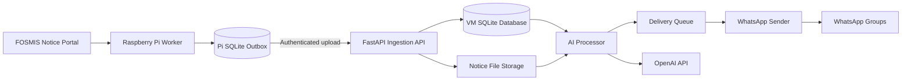

<div align="center">


# Laura

### Automated University Notice Assistant

A resilient Raspberry Pi + cloud pipeline that detects university notices, transfers them safely to a VM, extracts useful information with AI, and delivers the original notice with a concise summary to WhatsApp groups.


</div>


---

## Overview

**Laura** is an end-to-end notice automation system built to reduce the need to repeatedly check the University of Ruhuna FOSMIS notice portal manually.

The current architecture separates the system into two machines:

- a **Raspberry Pi worker** on the network that can access FOSMIS
- a **VM service** responsible for secure ingestion, AI processing, persistent state, and WhatsApp delivery

The design is intentionally fault tolerant. A temporary portal outage, VM outage, process restart, duplicate upload, AI failure, or WhatsApp delivery failure should not silently lose a notice.

## Architecture



### Processing flow

1. The Raspberry Pi signs in to FOSMIS and scans the notice table.
2. Each visible notice receives a deterministic SHA-256 `notice_key`.
3. Previously seen notices are ignored using local SQLite state.
4. New notice files are downloaded atomically and stored in a durable outbox.
5. Pending notices are uploaded to the VM using an authenticated, idempotent API request.
6. The VM verifies the notice metadata and uploaded file hash before accepting it.
7. The AI worker extracts useful academic information from supported documents.
8. A WhatsApp delivery job is created for each configured group.
9. The original notice and an AI-generated overview are delivered through Green API.

## Key Features

### Reliable notice detection

Laura does not rely only on a notice date or the newest row on the website. A notice identity is derived from normalized notice data, including its source, title, website timestamp, and download URL.

This allows the worker to detect previously unseen notices even when the portal contains duplicate timestamps or slightly out-of-order entries.

### Durable local outbox

The Raspberry Pi stores notice state in SQLite before attempting delivery to the VM. If the VM or network is unavailable, the notice remains queued and can be retried later instead of being lost.

### Safe file handling

- Downloads use temporary `.part` files before being finalized.
- Uploaded files are verified with SHA-256 hashes.
- The VM enforces a configurable upload size limit.
- Original filenames are preserved where possible while unsafe path characters are removed.

### Idempotent VM ingestion

The FastAPI receiver accepts an `Idempotency-Key` matching the notice key. Re-uploading the same notice therefore returns a duplicate acknowledgement rather than creating duplicate records or duplicate work.

### AI-powered notice understanding

For supported notice formats, Laura extracts:

- subject/module code
- subject/module name
- degree programme
- semester, level, academic year, or examination session
- explicit deadlines
- a short factual summary

PDFs are rendered for visual analysis, image notices can be processed directly, and text/HTML notices can be analyzed as text.

If a file type is unsupported or AI processing repeatedly fails, the system can still queue the original notice for delivery instead of blocking it permanently.

### WhatsApp delivery

WhatsApp messages can include:

- the notice title
- notice date/time
- source
- original notice URL
- original document when supported
- extracted academic information
- deadline information
- a short AI-generated summary

AI-generated information is clearly marked as something users should verify against the original notice.

### Recovery and retry behavior

The project includes protection for several failure modes:

- overlapping worker executions
- FOSMIS connection failures
- interrupted file downloads
- VM downtime
- duplicate uploads
- stale AI-processing jobs
- AI retry exhaustion
- stale WhatsApp delivery jobs
- repeated WhatsApp delivery failures

## Repository Structure

```text
OMNI_APIv2/
├── ruh-pi-worker/          # FOSMIS scraping + local durable outbox
│   ├── scraper_worker.py
│   ├── sender_worker.py
│   ├── outbox_db.py
│   ├── run_cycle.py
│   ├── healthcheck.py
│   ├── setup_pi.sh
│   ├── requirements-pi.txt
│   └── .env.example
│
├── ruh-vm-service/         # Ingestion API + AI + WhatsApp delivery
│   ├── ingestion_api.py
│   ├── ai_processor.py
│   ├── processor_worker.py
│   ├── whatsapp_sender.py
│   ├── database.py
│   ├── worker_cycle.py
│   ├── healthcheck.py
│   ├── setup_vm.sh
│   ├── start_api.sh
│   ├── start_tunnel.sh
│   ├── requirements-vm.txt
│   └── .env.example
│
└── old/                    # Earlier implementation kept for reference
```

## Tech Stack

| Area | Technology |
|---|---|
| Language | Python |
| Edge device | Raspberry Pi |
| Scraping | Requests + Beautiful Soup |
| Local persistence | SQLite |
| VM API | FastAPI + Uvicorn |
| Document processing | PyMuPDF |
| AI processing | OpenAI API |
| Messaging | Green API / WhatsApp |
| Scheduling | Cron |
| Remote exposure | Cloudflare Tunnel support |

## Installation

### 1. Clone the repository

```bash
git clone https://github.com/Mwick01/OMNI_APIv2.git
cd OMNI_APIv2
```

## Raspberry Pi Worker

The Pi is responsible only for reaching FOSMIS, detecting new notices, downloading them, and forwarding them to the VM.

### Setup

```bash
cd ruh-pi-worker
chmod +x setup_pi.sh
./setup_pi.sh
nano .env
```

Configure at minimum:

```env
SITE_USERNAME=your_fosmis_username
SITE_PASSWORD=your_fosmis_password

VM_INGEST_URL=https://your-ingestion-endpoint/api/v1/notices
PI_API_TOKEN=your_shared_secret
PI_DEVICE_ID=ruh-pi-zero-w
```

The provided environment example also exposes settings for scan windows, batch sizes, connection timeouts, maximum file size, and hash verification.

### Test manually

```bash
./venv/bin/python run_cycle.py
./venv/bin/python healthcheck.py
```

### Logs

```bash
tail -f logs/pi-worker.log
```

The setup script prints the cron entry required to run the worker automatically. The repository currently includes a five-minute example schedule.

## VM Service

The VM receives notices from the Pi, stores them, runs AI analysis, and sends them to configured WhatsApp groups.

### Setup

```bash
cd ruh-vm-service
chmod +x setup_vm.sh
./setup_vm.sh
nano .env
```

Configure at minimum:

```env
PI_API_TOKEN=the_same_secret_used_on_the_pi
ALLOWED_PI_DEVICES=ruh-pi-zero-w

OPENAI_API_KEY=your_openai_api_key
OPENAI_MODEL=gpt-4.1-nano

GREEN_API_INSTANCE=your_instance_id
GREEN_API_TOKEN=your_green_api_token
WHATSAPP_GROUP_IDS=group1@g.us,group2@g.us
```

### Start the ingestion API

```bash
./start_api.sh
```

By default, the API binds to:

```text
127.0.0.1:8100
```

### Run a processing cycle manually

```bash
./venv/bin/python worker_cycle.py
```

### Health check

```bash
./venv/bin/python healthcheck.py
```

### Logs

```bash
tail -f logs/api.log
tail -f logs/worker.log
```

`setup_vm.sh` also prints recommended cron entries for API startup/watchdog checks and the processing worker.

## Ingestion API

### Health

```http
GET /health
```

Returns basic service and database statistics.

### Upload a notice

```http
POST /api/v1/notices
```

The request is authenticated using a Bearer token and can additionally restrict uploads to configured Pi device IDs.

Important headers include:

```text
Authorization: Bearer <PI_API_TOKEN>
X-Pi-Device: <PI_DEVICE_ID>
Idempotency-Key: <notice_key>
```

The uploaded notice includes its metadata, SHA-256 file hash, and the original document as multipart form data.

## Configuration Highlights

### Raspberry Pi

| Variable | Purpose |
|---|---|
| `SITE_USERNAME` / `SITE_PASSWORD` | FOSMIS authentication |
| `INITIAL_LOOKBACK_HOURS` | Recent notices allowed during first bootstrap |
| `SCAN_ROW_LIMIT` | Maximum rows inspected per scan |
| `SCAN_OVERLAP_HOURS` | Recheck window for late/out-of-order entries |
| `MAX_FILE_MB` | Maximum downloaded file size |
| `VM_INGEST_URL` | VM ingestion endpoint |
| `PI_API_TOKEN` | Shared authentication secret |
| `PI_DEVICE_ID` | Pi identity sent to the VM |

### VM

| Variable | Purpose |
|---|---|
| `PI_API_TOKEN` | Shared secret used by the Pi |
| `ALLOWED_PI_DEVICES` | Allowed sender device IDs |
| `MAX_UPLOAD_MB` | Maximum ingestion upload size |
| `OPENAI_API_KEY` | AI processing credential |
| `OPENAI_MODEL` | Model used for notice analysis |
| `PROCESS_BATCH_SIZE` | AI jobs processed per cycle |
| `GREEN_API_INSTANCE` | Green API instance |
| `GREEN_API_TOKEN` | Green API credential |
| `WHATSAPP_GROUP_IDS` | Destination WhatsApp groups |
| `DELIVERY_BATCH_SIZE` | WhatsApp jobs processed per cycle |

See each `.env.example` for the complete configuration.

## Reliability Design

A major goal of Laura is **at-least-once processing without accidental duplicate records**.

The pipeline combines:

- deterministic notice IDs
- SQLite-backed state on both machines
- atomic downloads
- SHA-256 file verification
- idempotent API ingestion
- retryable processing states
- stale-job recovery
- per-group delivery tracking
- file/process locking

This makes the system much more resilient than a simple scrape-and-send cron script.

## Security Notes

- Never commit `.env` files or real credentials.
- Use a long random value for `PI_API_TOKEN`.
- Keep the ingestion API bound to localhost when exposing it through a secure reverse proxy or tunnel.
- Restrict `ALLOWED_PI_DEVICES` where possible.
- Protect FOSMIS, OpenAI, Green API, and Cloudflare credentials separately.
- Rotate any credential immediately if it is accidentally committed or exposed.

## Legacy Implementation

The `old/` directory contains an earlier version of the project. The active architecture is split between `ruh-pi-worker/` and `ruh-vm-service/` and should be used for current deployments.

## Disclaimer

Laura is an independent automation project and is **not an official University of Ruhuna service**. AI-generated summaries may be incomplete or incorrect; the original university notice remains the authoritative source.

## Author

Built by [Menuja Wickramathilaka](https://github.com/Mwick01).
